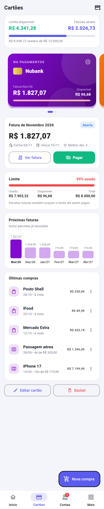
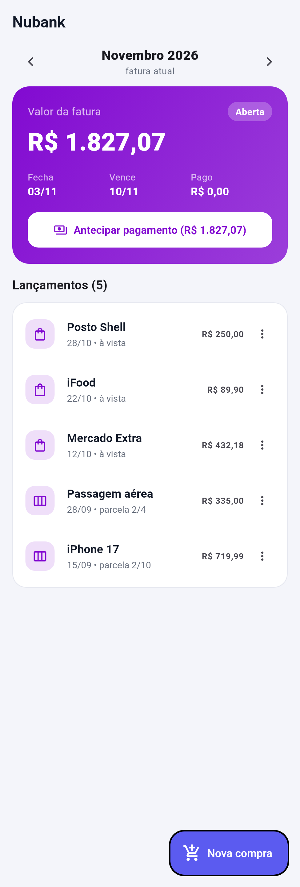
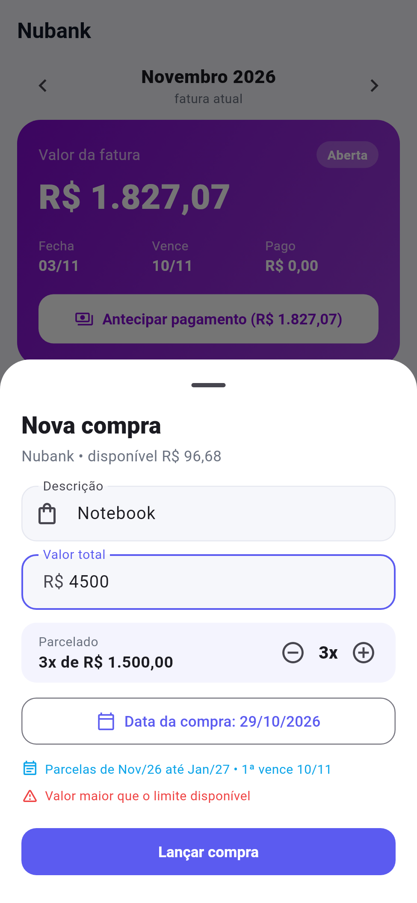

#  Finance Care

> Aplicativo de controle financeiro pessoal desenvolvido com Flutter + Firebase. Gerencie seu salário, contas, cartões de crédito, assinaturas e anotações em um só lugar.

---

##  Telas

| Início | Cartões | Fatura |
|---|---|---|
|  |  |  |

| Nova compra | Pagar fatura | Tema escuro |
|---|---|---|
|  |  |  |

O app tem navegação inferior com **Início**, **Cartões**, **Contas** e **Mais** (compras, assinaturas, renda extra, gráficos, relatórios, notas e calculadora).

---

##  Lógica do cartão de crédito

- **Compra no cartão não sai do saldo na hora.** Ela entra na fatura; o saldo só diminui quando você **paga a fatura** (na data do pagamento).
- **Fechamento e vencimento:** compras feitas *a partir* do dia de fechamento vão para a fatura seguinte. Se o dia de vencimento é menor ou igual ao de fechamento, a fatura vence no mês seguinte. O dia de fechamento é o "melhor dia de compra".
- **Parcelamento (até 24x):** cada parcela cai em uma fatura consecutiva. Os centavos que sobram da divisão vão para a 1ª parcela.
- **Limite:** o limite usado é tudo que foi comprado (inclusive parcelas futuras) menos o que já foi pago. Pagar uma fatura libera exatamente o valor pago.
- **Status da fatura:** *Aberta* → *Fechada* (após o fechamento) → *Atrasada* (após o vencimento sem pagamento total) ou *Paga*.
- **Pagamento parcial ou antecipado** é permitido; o restante continua em aberto. Pagamentos podem ser desfeitos.
- **Saldo** = salário + renda extra − assinaturas − contas pagas − compras PIX/dinheiro − faturas pagas no mês.
- **Previsto no fim do mês** = saldo − contas pendentes − faturas que vencem no mês.

Cartões do formato antigo (fatura em `usedLimit` + `installments`) são migrados automaticamente na primeira abertura.

---

##  Tecnologias

- [Flutter](https://flutter.dev/) 3.x
- [Firebase Auth](https://firebase.google.com/docs/auth)
- [Cloud Firestore](https://firebase.google.com/docs/firestore)
- [Provider](https://pub.dev/packages/provider) — gerenciamento de estado
- [intl](https://pub.dev/packages/intl) — formatação de moeda e datas
- [google_fonts](https://pub.dev/packages/google_fonts) — tipografia

---

## 📁 Estrutura do Projeto

```
lib/
├── main.dart
├── firebase_options.dart
│
├── models/
│   ├── user_model.dart
│   ├── account_model.dart
│   ├── card_model.dart
│   ├── subscription_model.dart
│   ├── bill_model.dart
│   └── note_model.dart
│
├── providers/
│   ├── auth_provider.dart
│   ├── home_provider.dart
│   ├── cards_provider.dart
│   ├── subscriptions_provider.dart
│   ├── bills_payable_provider.dart
│   └── notes_provider.dart
│
├── services/
│   ├── auth_service.dart
│   └── firestore_service.dart
│
├── screens/
│   ├── login_screen.dart
│   ├── home_screen.dart
│   ├── cards_screen.dart
│   ├── subscriptions_screen.dart
│   ├── bills_payable_screen.dart
│   ├── charts_screen.dart
│   └── notes_screen.dart
│
└── utils/
    └── constants.dart
```

---

##  Como Rodar o Projeto

### Pré-requisitos

- [Flutter SDK](https://docs.flutter.dev/get-started/install) instalado
- [Dart](https://dart.dev/get-dart) instalado
- Conta no [Firebase](https://firebase.google.com/)
- Editor: [VSCode](https://code.visualstudio.com/) ou [Android Studio](https://developer.android.com/studio)

### 1. Clone o repositório

```bash
git clone https://github.com/SEU_USUARIO/finance_care.git
cd finance_care
```

### 2. Instale as dependências

```bash
flutter pub get
```

### 3. Configure o Firebase

#### 3.1 Crie um projeto no Firebase Console

1. Acesse [console.firebase.google.com](https://console.firebase.google.com/)
2. Clique em **Adicionar projeto**
3. Dê o nome **Finance Care**
4. Clique em **Criar projeto**

#### 3.2 Ative os serviços

No painel do Firebase:

- **Authentication** → Método de login → E-mail/senha → Ativar
- **Firestore Database** → Criar banco de dados → Modo de teste

#### 3.3 Conecte o Flutter ao Firebase

```bash
dart pub global activate flutterfire_cli
flutterfire configure
```

Isso vai gerar automaticamente o arquivo `lib/firebase_options.dart`.

### 4. Rode o aplicativo

```bash
flutter run
```

---

##  Regras do Firestore

Copie estas regras no console do Firebase (Firestore → Regras):

```javascript
rules_version = '2';
service cloud.firestore {
  match /databases/{database}/documents {
    match /users/{userId}/{document=**} {
      allow read, write: if request.auth.uid == userId;
    }
  }
}
```

---

##  Dependências (pubspec.yaml)

```yaml
dependencies:
  flutter:
    sdk: flutter
  firebase_core: ^2.24.0
  firebase_auth: ^4.15.0
  cloud_firestore: ^4.14.0
  provider: ^6.0.0
  intl: ^0.19.0
  google_fonts: ^6.1.0
```

---

##  Estrutura do Firestore

```
users/
└── {uid}/
    ├── accounts/
    │   └── {accountId}/
    │       ├── salary: number
    │       └── bills: array
    │
    ├── cards/
    │   └── {cardId}/
    │       ├── cardName, bankName: string
    │       ├── limit: number
    │       ├── invoiceClosingDay, invoiceDueDay: number
    │       ├── colorValue: number
    │       └── ledgerVersion: number
    │
    ├── card_transactions/     (compras no cartão)
    │   └── {id}/ cardId, description, totalAmount, installments,
    │             purchaseDate, firstInvoice ("YYYY-MM")
    │
    ├── card_payments/         (pagamentos de fatura)
    │   └── {id}/ cardId, amount, date, invoice ("YYYY-MM")
    │
    ├── subscriptions/
    │   └── {subscriptionId}/
    │       ├── name: string
    │       ├── monthlyValue: number
    │       └── description: string
    │
    ├── bills/
    │   └── {billId}/
    │       ├── name: string
    │       ├── amount: number
    │       ├── dueDate: string
    │       ├── isPaid: boolean
    │       └── urgency: string  ("leve" | "moderado" | "urgente")
    │
    └── notes/
        └── {noteId}/
            ├── title: string
            ├── content: string
            ├── createdAt: string
            └── updatedAt: string
```

---

## 📄 Licença

Este projeto está sob a licença MIT. Veja o arquivo [LICENSE](LICENSE) para mais detalhes.

---

## 👤 Autor Cardoso

Feito com Flutter + Firebase.
